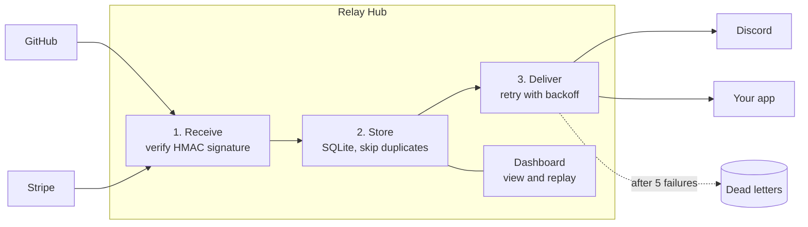

# Webhook Relay Hub

**Webhooks get lost, duplicated, and forged. This service makes sure they don't.**

The Relay Hub sits between the apps that send webhooks (GitHub, Stripe, Shopify...) and the apps that need them. Every incoming message is checked to be genuine, saved exactly once, and delivered to each subscribed app, with automatic retries when a receiver is down. A live dashboard shows every message, and any delivery can be replayed with one click.

Built with C# / .NET 10, ASP.NET Core Minimal APIs, Entity Framework Core and SQLite.



## What it handles

| Problem | How the hub handles it |
| --- | --- |
| **Forged messages** | Every webhook's HMAC-SHA256 signature is verified with a fixed-time comparison. Anything unsigned or tampered with gets `401`. |
| **Duplicates** | Senders retry, so the same event can arrive twice. A unique index on `(source, deliveryId)` means it's stored and delivered once. |
| **Receivers that are down** | A background worker retries with exponential backoff (2s, 4s, 8s, 16s...). After 5 failures the message becomes a dead letter instead of disappearing. |
| **Slow senders' timeouts** | The hub replies `202 Accepted` immediately and delivers in the background, so senders never time out waiting on downstream apps. |
| **"What happened to that order?"** | A dashboard shows each message, every delivery attempt and the last error. Fix the receiver, press **Replay**. |

## Run it

You'll need the [.NET 10 SDK](https://dotnet.microsoft.com/download).

```bash
dotnet run --project src/RelayHub
```

Open http://localhost:5080 for the dashboard. In another terminal, send a signed test webhook:

```powershell
./scripts/send-test-webhook.ps1                 # a normal delivery
./scripts/send-test-webhook.ps1 -Duplicate      # sent twice, stored once
./scripts/send-test-webhook.ps1 -BadSignature   # rejected with 401
```

Three demo receivers are built in so you can watch each outcome:

- `echo` always succeeds.
- `flaky` fails 60% of the time, so you can watch the retries.
- `broken` always fails and ends up as a dead letter.

### Connect real GitHub webhooks

1. Expose your local hub with a tunnel such as [smee.io](https://smee.io) or `ngrok http 5080`.
2. In your GitHub repo, go to **Settings → Webhooks → Add webhook**. Set the payload URL to `https://<tunnel>/webhooks/github`, the content type to `application/json`, and choose a secret.
3. Put the same secret in `Relay:Sources:github:Secret`. Use `dotnet user-secrets` or an environment variable for this, never a committed file.

## Configuration

Everything lives in `src/RelayHub/appsettings.json` under `Relay`:

```jsonc
"Relay": {
  "MaxAttempts": 5,           // attempts before dead-lettering
  "BaseDelaySeconds": 2,      // first retry wait; doubles each time
  "Sources": {                // who may send to /webhooks/{name}
    "github": { "SignatureHeader": "X-Hub-Signature-256", "DeliveryIdHeader": "X-GitHub-Delivery", ... }
  },
  "Targets": [                // where messages go; "Sources" filters which ones
    { "Name": "echo", "Url": "http://localhost:5080/demo/echo" }
  ]
}
```

Secrets are empty in `appsettings.json` and only filled in `appsettings.Development.json` for local use. A source with no secret rejects everything.

## API

| Method | Path | Purpose |
| --- | --- | --- |
| `POST` | `/webhooks/{source}` | Receive a webhook |
| `GET` | `/api/messages?status=Pending\|Delivered\|DeadLettered` | Recent messages with their deliveries |
| `GET` | `/api/stats` | Delivery counts by status |
| `POST` | `/api/deliveries/{id}/replay` | Put a delivery back in the queue |
| `GET` | `/health` | Health check |

## Tests

```bash
dotnet test
```

The tests cover signature checks (including GitHub's published test vector), backoff timing, and the endpoint end to end against an in-memory server: accept, reject, de-duplicate, deliver, and dead-letter after repeated failures.

## Docker

```bash
docker build -t relay-hub .
docker run -p 8080:8080 -v relay-data:/data -e Relay__Sources__github__Secret=<secret> relay-hub
```

## Project layout

```
src/RelayHub/
  Program.cs                  endpoints: receive, dashboard API, demo targets
  RelayOptions.cs             configuration model
  Security/SignatureVerifier  HMAC verification
  Data/                       EF Core models + DbContext
  Workers/DeliveryWorker      background delivery with retries
  Workers/RetryPolicy         exponential backoff
  wwwroot/index.html          dashboard
tests/RelayHub.Tests/         xUnit tests
scripts/send-test-webhook.ps1 signed test sender
```

## Ideas for what's next

- Add jitter to the backoff so many retries don't all fire at the same moment
- Sign outgoing deliveries so receivers can verify the hub too
- Per-target circuit breaker: pause a target that keeps failing
- Swap SQLite for PostgreSQL and the polling worker for a queue (Azure Service Bus, RabbitMQ)
- Authentication on the dashboard
